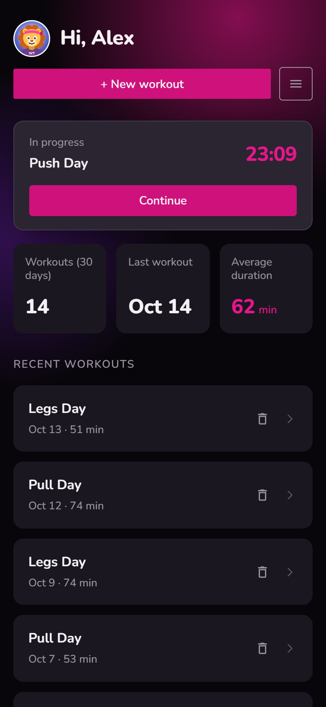
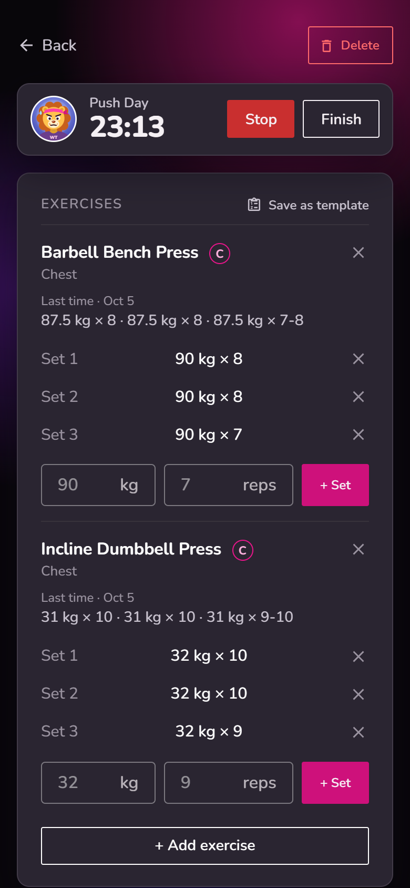
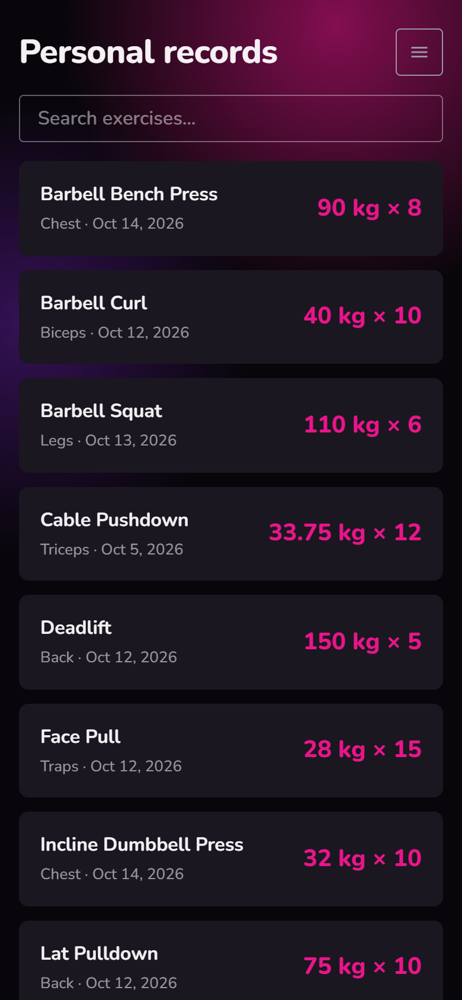
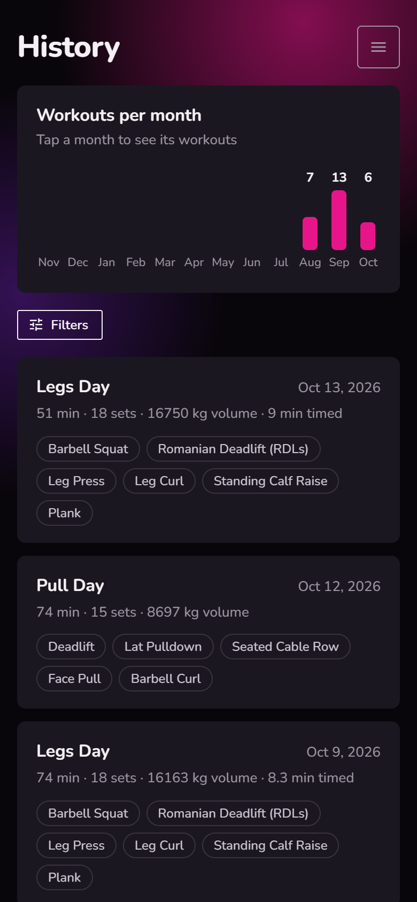
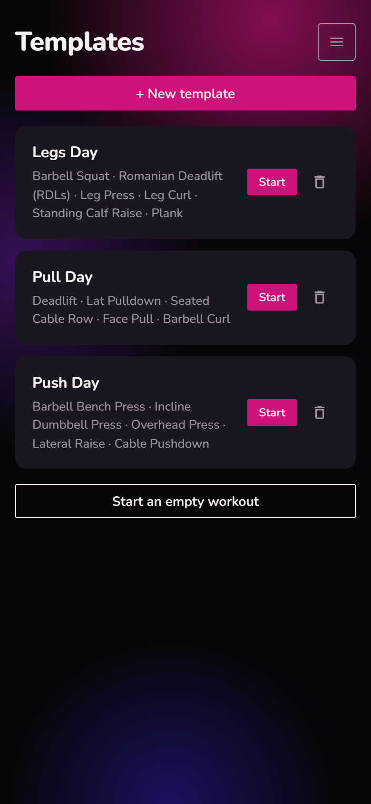
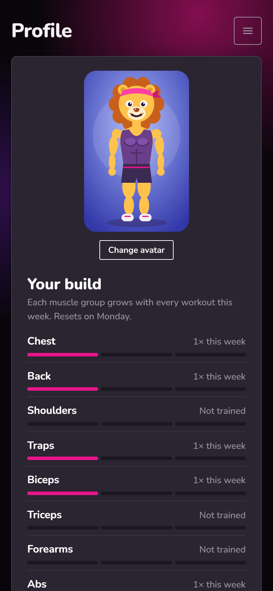
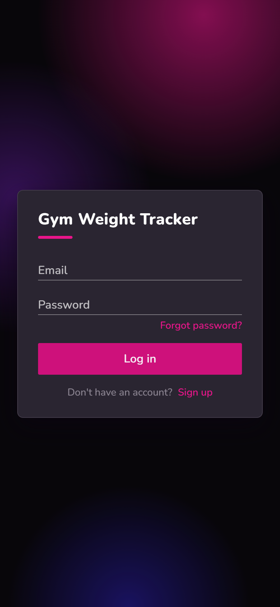

<h1 align="center">Gym Weight Tracker</h1>

<p align="center">
  Log your sets between reps, see what you lifted last time, and watch your records go up.
</p>

<p align="center">
  
  
  
  
</p>

<p align="center">
  
  &nbsp;
  
  &nbsp;
  
</p>

## What it does

Gym Weight Tracker is a workout log built for a phone held in one hand, between sets. The two
things it puts first:

- **Fast logging.** Weight and reps, one tap on **+ Set**, done. An empty field repeats the
  matching set from last time, so repeating a set takes a single tap.
- **Last time is always in view.** Every exercise in a workout shows the sets you did the
  previous time, right above the fields where you log today's.

Everything else:

- **Workout timer** that can be stopped, resumed and finished.
- **Templates**: save a workout once (Push Day, Pull Day...) and start it again with one tap.
- **Personal records** per exercise, with a celebration when you beat one mid-workout.
- **History** with workouts per month, volume, sets and duration for each session.
- **Profile** with a chosen avatar and a weekly view of which muscle groups you trained.
- **Exercise catalog** grouped by muscle group, plus your own custom exercises. Compound
  exercises are marked with a **C**.
- **Flexible input**: decimal comma or period (`82,5` or `82.5`), rep ranges like `9-10` when the
  last rep was a struggle, minutes for timed exercises such as planks and cardio.
- **Accounts** with email confirmation and password reset.

## Screenshots

| Dashboard | Workout in progress | Personal records |
| :---: | :---: | :---: |
|  |  |  |
| **History** | **Templates** | **Profile** |
|  |  |  |

<p align="center">
  
</p>

<sub>The screenshots use demo data.</sub>

## Tech stack

| | |
| --- | --- |
| Frontend (this repo) | Vue 3, Vuetify 4, Vite, Vue Router, Axios |
| Backend | Laravel 12 API with Sanctum: [gym-weight-tracker-backend](https://github.com/rmsddd/gym-weight-tracker-backend) |
| Database | MySQL |
| Hosting | One Docker image on Render: Laravel serves the API and the built Vue app |

## Running it locally

The app needs the [backend](https://github.com/rmsddd/gym-weight-tracker-backend) running on
`http://localhost:8000`; see its README to set it up. Then:

```sh
npm install
npm run dev
```

Open `http://localhost:5173`.

| Command | What it does |
| --- | --- |
| `npm run dev` | Dev server with hot reload |
| `npm run build` | Production build into `dist/` |
| `npm run preview` | Serves the production build locally |
| `npm run lint` | oxlint and ESLint, with fixes |
| `npm run format` | Prettier on `src/` |

In production there is no separate frontend deploy: the backend's Dockerfile clones this repo,
builds it and serves `dist/` from Laravel, so the API calls stay on the same address.
